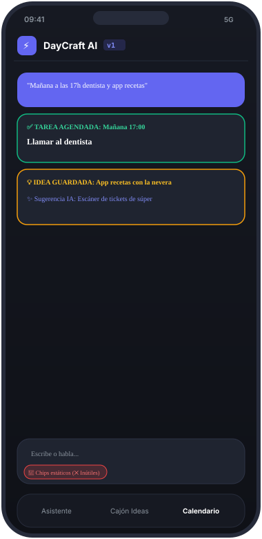
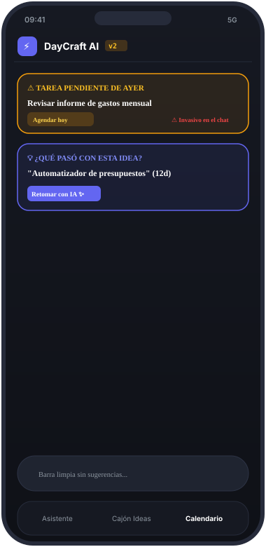
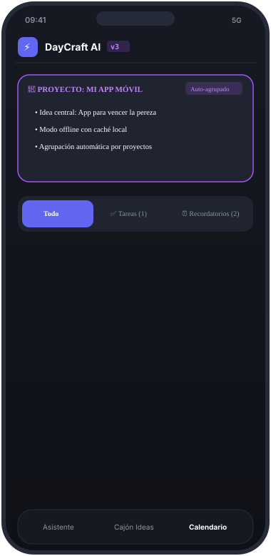
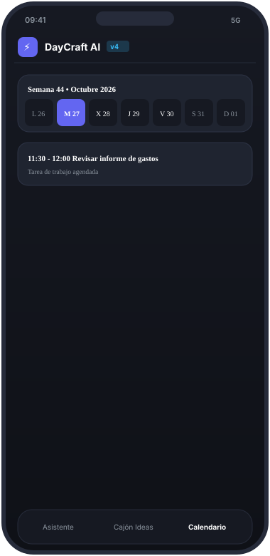
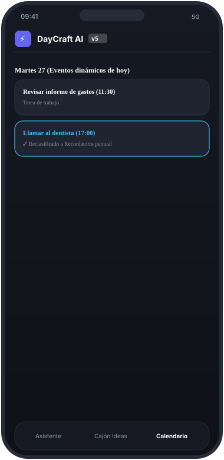
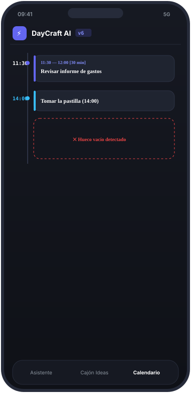
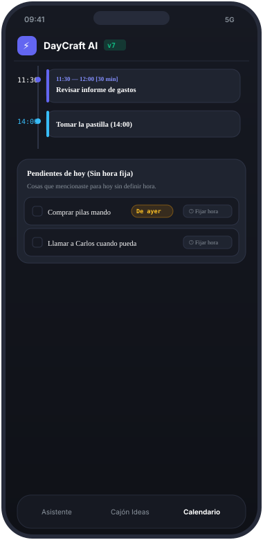

# 🛠️ DayCraft AI — Bitácora de Desarrollo y Mockups Móviles

Este documento recoge el proceso evolutivo de creación y diseño de **DayCraft AI**, documentando visualmente con imágenes cómo fue transformándose la interfaz móvil en cada versión (v1 a v7) a partir del feedback de Deimar.

> 📱 El prototipo interactivo ejecutable se encuentra en: [`mockup-mobile.html`](mockup-mobile.html)

---

## 📑 Galería de Versiones
1. [v1: Concepto Inicial y Entrada Mixta](#v1-concepto-inicial-y-entrada-mixta)
2. [v2: Eliminación de Ruido y Banners Proactivos](#v2-eliminación-de-ruido-y-banners-proactivos)
3. [v3: Campana No Intrusiva, Ideas Agrupadas y Tareas vs Recordatorios](#v3-campana-no-intrusiva-ideas-agrupadas-y-tareas-vs-recordatorios)
4. [v4: Retorno del Calendario Semanal e Iconos Notion](#v4-retorno-del-calendario-semanal-e-iconos-notion)
5. [v5: Consistencia Extrema, Cero Emojis y Calendario Dinámico](#v5-consistencia-extrema-cero-emojis-y-calendario-dinámico)
6. [v6: Time-Blocking Profesional y Mensajes Contextuales](#v6-time-blocking-profesional-y-mensajes-contextuales)
7. [v7 (Final): Pendientes de Hoy sin Hora Fija y Rollover Antiestrés](#v7-final-pendientes-de-hoy-sin-hora-fija-y-rollover-antiestrés)

---

## v1: Concepto Inicial y Entrada Mixta

### Planteamiento y Feedback
* **Objetivo inicial**: Deimar propuso una app para vencer la pereza de organizarse. El usuario habla o escribe en lenguaje natural y la IA separa tareas e ideas.
* **Problema detectado por Deimar**: Las sugerencias genéricas debajo del buscador no tenían sentido y ensuciaban la pantalla.

  

---

## v2: Eliminación de Ruido y Banners Proactivos

### Planteamiento y Feedback
* **Cambios**: Se eliminaron los botones de sugerencias estáticas y se añadieron alertas para tareas atrasadas e ideas inactivas.
* **Problema detectado por Deimar**: Los banners en mitad de la pantalla resultaban demasiado invasivos. Se requería un acceso discreto como una campana. Además, las ideas debían agruparse por proyectos y el calendario debía distinguir Tareas de Recordatorios.

  

---

## v3: Campana No Intrusiva, Ideas Agrupadas y Tareas vs Recordatorios

### Planteamiento y Feedback
* **Cambios**:
  * Campana superior discreta `🔔 [2]` con panel desplegable flotante.
  * Auto-agrupación de ideas dentro de proyectos afines (ej: *"Proyecto: Mi App Móvil"*).
  * División conceptual: Tareas de trabajo vs Recordatorios puntuales.
* **Problema detectado por Deimar**: Al separar las tareas se eliminó la vista visual del calendario semanal, la cual Deimar quería conservar. Solicitó además adoptar la iconografía de `notionicons.so`.

  

---

## v4: Retorno del Calendario Semanal e Iconos Notion

### Planteamiento y Feedback
* **Cambios**:
  * Tira semanal visual de 7 días (L, M, X, J, V, S, D).
  * Renombrado a **Cajón de Ideas**.
  * Incorporación inicial de iconos minimalistas de Notion.
* **Problema detectado por Deimar**:
  * Se usó la palabra *"Avisos"* en vez de *"Recordatorios"*.
  * *"Llamar al dentista"* figuraba como tarea en lugar de recordatorio.
  * La agenda no cambiaba al seleccionar diferentes días de la semana y aún quedaban emojis de colores.

  

---

## v5: Consistencia Extrema, Cero Emojis y Calendario Dinámico

### Planteamiento y Feedback
* **Cambios**:
  * Erradicación total de emoticonos de colores; 100% iconos vectoriales SVG de trazo fino estilo Notion.
  * Reclasificación de *"Llamar al dentista"* como Recordatorio puntual.
  * Calendario dinámico real: cada día muestra únicamente sus eventos.
* **Problema detectado por Deimar**:
  * La hora "11:30 - 12:00" en texto plano dentro de una tarjeta lucía poco estética.
  * Se necesitaban mensajes empáticos en días libres (*"tómate un descanso"*).

  

---

## v6: Time-Blocking Profesional y Mensajes Contextuales

### Planteamiento y Feedback
* **Cambios**:
  * **Timeline con Raíl Horario**: Eje vertical a la izquierda. Tareas como bloques proporcionales con hora de inicio, fin y duración (`30 min`). Recordatorios como pines en la hora exacta.
  * **Mensajes Contextuales**: En días vacíos se muestra un mensaje adaptativo según si es hoy (*"Tómate un descanso"*), futuro (*"Día despejado"*) o pasado (*"Día concluido"*).
* **Problema detectado por Deimar**:
  * En días con pocos eventos quedaba un espacio vertical vacío entre la timeline y el chat inferior.
  * Propuso una sección para tareas que se mencionan sin definir hora.

  

---

## v7 (Final): Pendientes de Hoy sin Hora Fija y Rollover Antiestrés

### Planteamiento y Solución Definitiva
* **Novedades**:
  * **Sección "Pendientes de hoy (Sin hora fija)"**: Aprovecha el espacio inferior de forma natural al hacer scroll. Contiene las tareas mencionadas por voz sin hora fija con checkbox y botón *"Fijar hora"*.
  * **Rollover Automático y Etiqueta `[ De ayer ]`**: Tareas no completadas pasan al día siguiente con una pastilla estilizada en una sola línea (`whitespace-nowrap`), sin romperse en dos renglones.
  * **Regla Antiestrés de los 3 Días**: Si una tarea se aplaza 3 días, la campana ofrece moverla a ideas o archivarla sin generar culpa.

  

---

*Mockup interactivo ejecutable:* [`mockup-mobile.html`](mockup-mobile.html)
